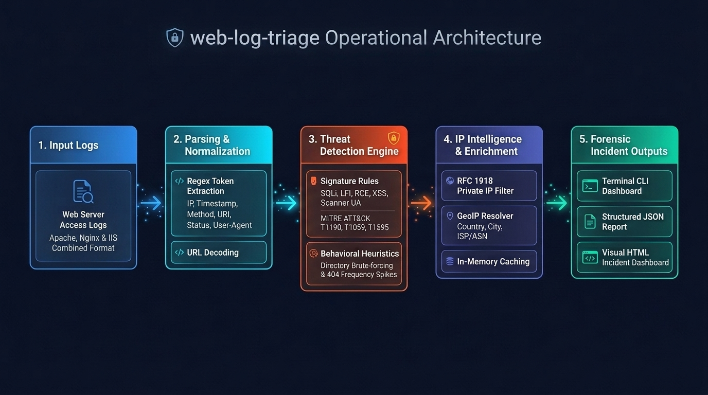

# Automated Web Server Access Log Threat Hunter (`web-log-triage`)

A lightweight Python forensic command-line tool that parses standard web server access logs (Apache, Nginx, or IIS Common/Combined Log Format), applies high-fidelity regular expressions to detect common attack vectors mapped to **MITRE ATT&CK®**, enriches IP addresses, and outputs structured **JSON** and interactive **HTML** forensic reports.

---

## Why `web-log-triage`?
Web server access logs are often the **first and most critical line of evidence** when an application is probed, fuzzed, or breached. However, security analysts and sysadmins typically face a dilemma:
- **Heavy Enterprise SIEMs** (Splunk, Datadog, Elastic) are costly, complex to configure, and require shipping sensitive logs off-premise.
- **Ad-hoc CLI utilities** (`grep`, `awk`, `cut`) are tedious, miss multi-line behavioral patterns (like directory brute-forcing), and fail to decode obfuscated URL-encoded payloads.
**`web-log-triage` bridges this gap.** It is a standalone, lightweight, zero-dependency threat hunter designed to turn raw, multi-gigabyte access logs into structured forensic intelligence in seconds.

---

## Core Goals & Design Philosophy

1. **Zero External Dependencies:** Built using Python's standard library (with optional `rich` formatting), ensuring it runs out-of-the-box on air-gapped forensic workstations or minimal production servers.
2. **Dual-Pass Detection Engine:**
   - **Signature Inspection:** Evaluates individual requests against high-fidelity regexes for SQLi, LFI, RCE, and reconnaissance tools.
   - **Behavioral Heuristics:** Aggregates error bursts (`404`/`403`) across time to detect automated scanners (Gobuster, DirBuster, ffuf).
3. **Anti-Evasion & URL Normalization:** Automatically unquotes URL encodings (`%20` $\rightarrow$ space, `%27` $\rightarrow$ `'`, `%2f` $\rightarrow$ `/`) before analysis, preventing attackers from bypassing rules with simple obfuscation.
4. **MITRE ATT&CK® Alignment:** Every alert is pre-mapped to official ATT&CK Enterprise techniques (`T1190`, `T1059.004`, `T1595`) to accelerate incident response escalation.
5. **Memory-Safe Streaming:** Utilizes Python lazy generators to stream through multi-gigabyte log files line-by-line without causing system memory exhaustion.
6. **Multi-Format Reporting:** Instant terminal dashboard for quick scoping, structured JSON for SIEM ingestion, and self-contained HTML reports for executive reporting.

---

## Architecture & Operational Pipeline


---

## Quickstart & Installation

Choose your preferred setup method:

### Linux & macOS (Using `make`)

If you are on Linux or macOS, you can use the automated `Makefile`:

```bash
# 1. Setup virtual environment and install in editable mode
make install

# 2. Run the test suite
make test

# 3. Run triage on sample logs
make run

# 4. Generate visual HTML report
make html

# 5. Generate JSON report for tool ingestion
make json

# 6. Remove virtualenv, caches, and report file
make clean
```

### Windows (PowerShell/Python)

If you are on Windows, you can use the automated `wlt-setup.ps1`

```powershell
# 1. Setup virtual environment and install dependencies
.\wlt-setup.ps1 install

# 2. Run the test suite
.\wlt-setup.ps1 test

# 3. Run triage on sample logs
.\wlt-setup.ps1 run

# 4. Generate visual HTML report
.\wlt-setup.ps1 html

# 5. Generate JSON report
.\wlt-setup.ps1 json

# 6. Remove virtualenv, caches, and report file
.\wlt-setup.ps1 clean
```

---

## Sample Terminal Output

```text
=================================================================
 WEB LOG TRIAGE - FORENSIC SUMMARY
=================================================================
 Total Requests Analyzed : 8
 Unique IP Addresses     : 5
 Total Threats Detected  : 12
=================================================================

[+] Top Offending IPs & Network Geolocation:
  203.0.113.99     :  5 alerts | Location: Internal/Private (Local Network)
  198.51.100.12    :  4 alerts | Location: Internal/Private (Local Network)
  203.0.113.45     :  2 alerts | Location: Internal/Private (Local Network)
  192.0.2.88       :  1 alerts | Location: Internal/Private (Local Network)

[+] Threat Categories Breakdown:
  • Scanner                : 4
  • Sensitive File Access  : 3
  • LFI                    : 2
  • SQLi                   : 1
  • RCE                    : 1
  • Brute Force            : 1

[+] Detailed Threat Findings:
  [ 1] [High    ] SQLi         (MITRE T1190) from 203.0.113.45
       Payload : UNION SELECT
       URI     : /products.php?id=1 UNION SELECT null,username,password FROM users
  [ 2] [Critical] RCE          (MITRE T1059.004) from 192.0.2.88
       Payload : whoami
       URI     : /cgi-bin/test.sh?cmd=whoami;id
  [ 3] [High    ] Brute Force  (MITRE T1595.003) from 203.0.113.99
       Payload : Potential directory brute-force: 3 failed requests
       URI     : /.env
=================================================================
```

---

## CLI Usage & Options

```bash
usage: web-log-triage [-h] [-f {console,html,json}] [-o OUTPUT] [--threshold THRESHOLD] [--no-geoip] log_file

Automated Web Server Access Log Threat Hunter & Forensic Triage Tool

positional arguments:
  log_file              Path to access log file (Combined or Common log format)

options:
  -h, --help            Show this help message and exit
  -f, --format {console,html,json}
                        Report format: console, html, or json (default: console)
  -o, --output OUTPUT   Output file path for html/json reports
  --threshold THRESHOLD
                        Brute-force 404/403 request threshold (default: 3)
  --no-geoip            Disable online GeoIP lookups (offline mode)
```

---

## Threat Detection & MITRE ATT&CK® Mapping


| Threat Category | Target Field | MITRE Technique | MITRE Tactic | Description |
| -------- | -------- | -------- | -------- | -------- |
| SQL Injection (SQLi)    | decoded_uri   | T1190   | Initial Access | **UNION SELECT**, **OR 1=1**, database function injection |
| Local File Inclusion (LFI)    | decoded_uri   | T1190   | Initial Access | Path traversal *(../, ..\\)* and */etc/passwd* probing |
| Remote Code Execution (RCE) | decoded_uri | T1059.004 | Execution | Command injection **whoami;id** |
| Malicious Scanners | user_agent | T1595.002 | Reconnaissance | Known offensive tools (sqlmap, gobuster, nikto, nmap) |
| Directory Brute-Force | multi-entry | T1595.003 | Reconnaissance | High-frequency 404/403 bursts from a single IP |
| Sensitive File Probing | decoded_uri | T1552.001 | Credential Access | Attempts to access */.env*, */.git*, config files |
| Cross-Site Scripting (XSS) | decoded_uri | T1059.007 | Execution | *\<script\>* injection, DOM event handlers, **javascript\:** |
| Cloud Metadata / SSRF | decoded_uri | T1552.005 | Credential Access | Probing AWS/Azure/GCP instance metadata (169.254.169.254) | 

---

## Troubleshooting, Common Issues, & Tips

### Linux / macOS

- **Check Virtual Environment Execution Permissions:**
  If you see a `Permission denied` error when running `make` commands:
  Ensure the generated binaries in `.venv` have execute permissions:
  ```bash
  chmod +x .venv/bin/*
  ```
- **Avoid Using 'sudo':**
  Never run *sudo make* or *sudo pip*. If *.venv* was accidentally created with *sudo*, fix file ownership to your current user:
  ```bash
  sudo chown -R $USER:$USER .
  ```
  Or remove and rebuild the environment cleanly:
  ```bash
  make clean
  make install
  ```
- **Filesystem Mount Flags (noexec):**
  If your project directory is located on an external drive or a network share mounted with the **noexec** flag, Linux/macOS will block binaries from running inside *.venv*. Move the project to your local home directory (e.g. *~/workspace/*).

### Windows

- **PowerShell Script Execution Disabled on Windows:**
  If PowerShell prevents script execution, run:
  ```powershell
  Set-ExecutionPolicy -ExecutionPolicy RemoteSigned -Scope CurrentUser
  ```

---

## Release Notes & Version History

### `v0.1.0` — Initial Release (October 2026)
- **Core Parser:** Streaming ingestion of Combined and Common Log Format (CLF) access logs with URL decoding.
- **Threat Detection Engine:**
  - Signature detection for SQLi, LFI, RCE, XSS, Cloud Metadata (SSRF), and malicious scanner User-Agents.
  - Multi-request behavioral anomaly detection for directory brute-force attacks (`404`/`403` frequency spikes).
  - Full alignment with **MITRE ATT&CK® Enterprise** techniques.
- **IP Intelligence:** In-memory cached IP enrichment distinguishing RFC 1918 private/bogon networks from public targets with GeoIP lookup.
- **Reporting Engine:**
  - Dynamic terminal dashboard summary with status code and threat distributions.
  - Machine-readable structured JSON export.
  - Self-contained, responsive HTML forensic report with modern dark theme and threat badges.
- **Cross-Platform Tooling:** Automated setup via `Makefile` (Linux/macOS) and `wlt-setup.ps1` (Windows PowerShell), plus `pyproject.toml` support.

---

### Future Roadmap
- [ ] Offline MaxMind GeoLite2 `.mmdb` database support
- [ ] Custom user rule loading from external YAML/JSON files
- [ ] Webhook alerting (Slack, Discord, Microsoft Teams)
- [ ] Support for JSON-formatted web server logs

---

## Author & Maintainer

- **Developer:** Gavin Kye / Cybersecurity Consultant
- **Role:** Security Engineer / Python Developer / Digital Forensic/IR/Malware Investigator
- **GitHub:** [@gkye-cyber](https://github.com/gkye-cyber)
- **LinkedIn:** [linkedin.com/in/yourprofile](https://linkedin.com/in/gavin-kyesr)
- **License:** Distributed under the MIT License. See [`LICENSE`](LICENSE) for details.